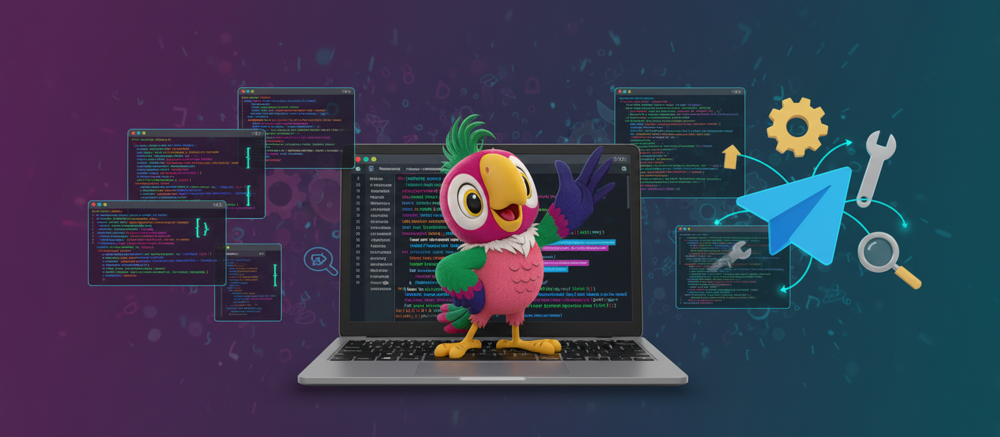

<p align="center">
  
</p>

<h1 align="center">Kesha TG Bot</h1>
<h3 align="center">Полноценный агент Claude Code (или Codex) прямо в чате Telegram</h3>

<p align="center">
  <sub><a href="README.md">English</a> · <b>Русский</b></sub>
</p>

<p align="center">
  <a href="#что-вы-получаете">Что получаете</a> ·
  <a href="#быстрый-старт">Быстрый старт</a> ·
  <a href="#путь-сообщения">Как это работает</a> ·
  <a href="#возможности">Возможности</a> ·
  <a href="#команды">Команды</a> ·
  <a href="#настройка">Настройка</a> ·
  <a href="#чего-бот-не-делает">Ограничения</a> ·
  <a href="CHANGELOG.md">Changelog</a>
</p>

<p align="center">
  <a href="LICENSE"></a>
  
  
</p>

---

**Кеша — одноузловой Telegram-бот, который даёт каждому чату собственную постоянную сессию агента.** Внутри официальный `claude-agent-sdk` (Claude Code CLI) и второй, переключаемый вручную рантайм на Codex CLI. Общаться с ним можно как в терминале Claude Code: он читает файлы, запускает команды, вызывает MCP-серверы и помнит разговор, но интерфейс — чат Telegram с голосовыми, фото, ответами, которые печатаются на глазах, и напоминаниями.

Бот строится вокруг одной рабочей директории (`WORK_DIR`): заметки, `CLAUDE.md`, `.mcp.json` и все инструменты агента лежат там. Базы «знаний», которую надо поддерживать, нет: агент ищет по вашим файлам и истории чата как по обычному тексту.

## Что вы получаете

| Возможность | Состояние |
|---|---|
| Постоянный агент на чат | Одна сессия на чат и рантайм хранится на диске и поднимается после рестарта бота. Чаты не делят состояние. |
| Два рантайма | Claude (по умолчанию) и Codex, переключение вручную через `/runtime`. Автоматического фейловера нет. |
| Ответ по мере печати | Ответ отправляется один раз и правится на месте; вызовы инструментов — в отдельном пузыре с таймерами. |
| Голос, фото, файлы | Голосовые и кружки расшифровываются (Deepgram, по желанию); фото, альбомы, документы, аудио и видео скачиваются и передаются агенту как файлы. |
| Генерация картинок | Через подключаемый инструмент хаба: Кеша предупреждает об ожидании около минуты и отправляет результат фотографией. Если хаб недоступен или вернул ошибку — одна попытка через платный Nano Banana. |
| Сообщения во время ответа | На Claude сообщение вливается в идущий ход, как набранный текст в Claude Code. На Codex ждёт следующего хода. |
| Контекст | Заполненность измеряется перед каждым сообщением; бот сам сжимает контекст до того, как окно кончится. |
| Память | История чата ищется как текст (`search_memory`, `read_messages`), заметки — через `rg`/Grep. Ни эмбеддингов, ни индекса, который надо перестраивать. |
| Напоминания | Три вида, в том числе будящие агента, чтобы он выполнил работу в заданное время. |
| Фоновые агенты | Субагенты, запущенные CLI, могут закончить после ответа; их результат приходит в чат сам. |
| Карточка лимитов | `/limits` показывает окна подписок, но только с сопутствующим сервисом Orchestra. |
| Безопасность | Белый список пользователей, песочница отправки файлов, мост инструментов с токеном. Сам агент работает с полными правами. |

Это сводка возможностей, а не обещание, что на вашем хосте настроены все необязательные части (Deepgram, Codex, Orchestra).

## Быстрый старт

**Нужно:** Python 3.12+, Git, токен бота от [@BotFather](https://t.me/BotFather) и залогиненный Claude Code на хосте (SDK управляет Claude Code CLI с учётными данными из `~/.claude`). По желанию: `ffmpeg` (кружки), ключ Deepgram (расшифровка голоса), залогиненный на хосте Codex CLI (второй рантайм).

```bash
git clone https://github.com/DrSeedon/kesha-tg-bot.git
cd kesha-tg-bot
python3 -m venv .venv && source .venv/bin/activate
pip install -r requirements.txt

claude auth login        # один раз, от имени пользователя, под которым будет работать бот

cp .env.example .env     # затем правим: TELEGRAM_BOT_TOKEN, ALLOWED_USERS
python bot.py
```

`python setup_wizard.py` спрашивает те же значения и пишет `.env`. `CLAUDE_MODEL` лучше не задавать, чтобы действовала модель из кода (см. [Настройка](#настройка)): в примере и в мастере остались более старые названия моделей.

**Задайте `ALLOWED_USERS`.** Если он пуст, бот отвечает любому, кто его нашёл, а агент умеет выполнять команды на вашей машине. Впишите свой Telegram id (незнакомому пользователю бот при отказе сам называет его id).

Откройте бота в Telegram, отправьте `/start` и пишите что угодно.

### Запуск как сервис

`kesha-bot.service` — шаблон с пользователем и путями автора: скопируйте, поправьте `User`, `WorkingDirectory`, `ExecStart`, затем:

```bash
sudo cp kesha-bot.service /etc/systemd/system/
sudo systemctl daemon-reload && sudo systemctl enable --now kesha-bot
```

Команда `/restart` и тул `restart_bot` вызывают `sudo systemctl restart <юнит>`, а имена юнитов зашиты в исходники (`handlers.py`, `kesha_tools.py`). Либо разрешите этот вызов без пароля и поправьте имена под свой юнит, либо не пользуйтесь этими двумя.

## Путь сообщения

```
Telegram ─► aiogram ─► handlers.py ─► ChatState (на чат) ─► рантайм ─► Claude Code CLI
                                          │                    └────► codex app-server
                                          │ дебаунс, склейка
                                          ▼
                              response_stream.py ─► правки ответа + пузырь тулов в Telegram
                                          ▲
        MCP-тулы (kesha_tools.py) ────────┘   внутри процесса для Claude,
                                              через unix-сокет для Codex
```

1. Обработчик добавляет к сообщению префикс, который читает агент: время, `msg_id`, отправитель, пометки пересылки и ответа (`[2026-01-01 12:00 +0700] [msg_id=7] [Имя (@user)]: [reply: "…"] текст`). Часы в префиксе жёстко стоят на UTC+7.
2. `ChatState` собирает сообщения за окно дебаунса (по умолчанию 3 с, `/debounce`, 0–30 с), ждёт незавершённые расшифровки, а фото без подписи ждёт до 10 с голосового, которое обычно идёт следом.
3. Перед ходом рантайм измеряет контекст. Если пачка пересечёт порог сжатия, бот сначала сжимает.
4. Ответ стримится в одно сообщение Telegram, которое правится на месте; вызовы тулов идут в отдельный пузырь. Готовый текст превращается в сущности Telegram.
5. Каждое сообщение и каждый ответ пишутся в `storage/messages.db` вместе со строкой расхода на ответ (токены, разбивка кеша, стоимость, если рантайм её отдаёт).

Каждый чат — небольшой конечный автомат (`idle → collecting → processing → compacting / stopping`), вся мутация состояния чата идёт через него, поэтому два пользователя не трогают сессии друг друга.

## Возможности

### 💬 Чат и медиа

- **Текст, ответы, пересылки.** Ссылки, спрятанные за текстом, разворачиваются в `текст (url)`; пересылки и ответы доходят до агента как `[Forwarded from …]` / `[reply: "…"]`.
- **Голосовые и кружки.** Расшифровка в Deepgram (Nova‑3, язык русский, результат кешируется по id файла). Без ключа агент получает путь к файлу. Кружки сначала проходят через `ffmpeg`.
- **Фото, альбомы, документы, аудио, видео.** Скачиваются под исходными именами в `MEDIA_DIR` и передаются как `[photo: путь]`, `[document: путь (имя)]` и т. д.; открывает их агент своими инструментами. Альбом склеивается в одно сообщение. Файл, который не скачался, помечается как «слишком большой». Загрузки кешируются по уникальному id файла Telegram.
- **Стикеры** передаются эмодзи. Всё нераспознанное, включая rich-сообщения Telegram, доходит до агента текстом, а не теряется.
- **Язык интерфейса** (русский или английский) берётся из языка Telegram пользователя; меню команд зарегистрировано на обоих. Часть системных уведомлений (прогресс сжатия, подпись `/limits`, приветствие при старте) только на русском.

### ⚡ Стриминг в рамках лимитов Telegram

- Первый кусок уходит сразу; дальше то же сообщение правится простым текстом, а итог перерисовывается Markdown-сущностями.
- Один бюджет правок на чат (примерно одна правка в 3,1 с) держит все живые пузыри ниже потолка Telegram. При flood-control бот переходит на отправку нового сообщения с удалением старого, поэтому ответ не замирает.
- **Пузырь тулов.** Каждый вызов — значок, короткая подсказка и живой таймер; через 60 с появляется «ещё работаю»; пузырь закрывается, когда начинается текст ответа, так что порядок сообщений не ломается. Показываются до 20 тулов.
- **`/stop`** прерывает ход, сохраняет частичный текст и останавливает фоновых агентов CLI (скажет, сколько).
- **Лимит шагов.** Ход ограничен 150 циклами тулов; упёршись в предел, бот один раз сам говорит «продолжай», после этого просит вас написать «продолжай».
- **Ошибки названы по существу.** Лимит подписки (с временем сброса, если рантайм его знает), переполненный контекст, вызов тула, который модель не смогла оформить, недоступная сохранённая сессия и отказ фильтра безопасности провайдера — у каждого свой текст. Ошибки квоты и контекста слепо не повторяются; прочие временные ошибки пересоздают сессию до двух раз.
- **Откат при отказе фильтра.** Если фильтр Anthropic отклонил сообщение, бот форкает сессию до этого сообщения, чтобы помеченный текст не портил следующие ходы.

### 🧠 Контекст: измерен, допущен, сжат

- **Допуск.** Перед каждой пачкой бот спрашивает рантайм, насколько заполнен контекст, и прибавляет размер входящего текста. При 88 % окна на Claude (90 % на Codex) он сначала сжимает, потом отправляет. Если измерить контекст не удалось, сообщение всё равно отправляется: отказывать должен провайдер.
- **После тяжёлого хода** контекст измеряется заново, чтобы один огромный вывод тула не загнал чат в стену незаметно.
- **Сжатие на Claude** — собственная транзакция бота (`compact.py`): модель пишет передаточную записку из десяти разделов (цель, решения, файлы, команды, незавершённое, неопределённости, последние сообщения пользователя и др.); текст проверяется, секреты вычищаются, три последних сообщения пользователя дописываются дословно кодом, сессия заменяется атомарно. При любой неудаче происходит откат на старую сессию. Саммари публикуется в чате. На этом шаге модели также велено обновить существующую заметку в рабочей директории, если всплыл устойчивый факт. Если контекст уже слишком полон для саммари, запасным путём идёт встроенный компактор CLI.
- **Сжатие на Codex** встроенное (`thread/compact/start`), поток сохраняется.
- **`/compact`** запускает его вручную (на Claude нужно не менее 16 000 свободных токенов, на Codex 12 000); `/clear` начинает чистую сессию.
- **Фоновые агенты учитываются.** Сжатие или `/clear` их убили бы, поэтому автоматическое сжатие ждёт их завершения, а `/clear` сообщает, сколько остановил.

### 🔀 Два рантайма

| | Claude | Codex |
|---|---|---|
| Бэкенд | `claude-agent-sdk` → Claude Code CLI | `codex app-server --stdio` (JSON‑RPC) |
| Модель по умолчанию | `CLAUDE_MODEL` (`claude-opus-5-5`) | `KESHA_CODEX_MODEL` (`gpt-6-sol`) |
| Сообщения посреди хода | вливаются в идущий ход | ждут следующего хода |
| Сжатие | собственная транзакция бота | встроенное |
| Процент контекста | да | после первого ответившего хода |
| Стоимость | да | нет |
| Фоновые агенты | да | нет |
| Возобновление после рестарта | да | да |

- `/runtime` показывает рантайм, модель и кнопки; переключают `/runtime codex`, `/claude` и `/codex`. Пока идёт ход, переключение отклоняется.
- Новый рантайм поднимается и проверяется до того, как старый отпущен. При успехе передаются последние видимые сообщения (до 40 сообщений, 24 000 символов); при неудаче чат остаётся где был и говорит об этом.
- Для каждого рантайма у чата отдельный файл сессии (`storage/sessions/<chat_id>` и `.codex`), поэтому возврат продолжает его собственную историю.
- Codex работает с приватным `CODEX_HOME` и только с теми MCP-серверами, которые ему даёт бот, а не с теми, что в вашей личной конфигурации Codex. Режим — `approvalPolicy=never` и `danger-full-access`.
- Переключение рассчитано на аварии (забаненная или исчерпанная подписка). Claude — рантайм по умолчанию и единственный с долгой эксплуатацией.
- Проба при переключении читает и окна квоты провайдера: на рантайм с подпиской на 100 % не переключат. В обычных ходах останавливает ход собственная ошибка лимита провайдера, бот сообщает её со временем сброса.

### 🧰 MCP-тулы

Собственные тулы бота отдаются Claude внутри процесса, а Codex — через локальный unix-сокет (`tool_bridge.py`, запуск через `kesha_mcp_proxy.py`).

| Тул | Что делает |
|---|---|
| `send_photo`, `send_file`, `send_video`, `send_audio`, `send_voice` | Отправляют файл в чат. Путь проверяется по белому списку (см. [Безопасность](#-безопасность)). |
| `react` | Ставит эмодзи-реакции на сообщения по `msg_id`. |
| `create_reminder`, `list_reminders`, `update_reminder`, `cancel_reminder` | CRUD напоминаний ([ниже](#-напоминания)). |
| `search_memory`, `read_messages` | Поиск по истории чата и чтение сообщений целиком ([ниже](#-память-как-обычный-текст)). |
| `set_debounce`, `toggle_debug`, `get_bot_status`, `restart_bot` | Агент может настраивать и осматривать самого бота. |
| `run_on_laptop` | Диагностика по белому списку команд через обратный SSH-туннель. Под автора; только Claude. |

Внешние MCP-серверы читаются из `~/.claude.json`, `~/.claude/settings.json` и `WORK_DIR/.mcp.json` (побеждает первый источник) и явно передаются CLI. Поправили один — выполните `/reload`: CLI перезапускается с новым набором, разговор сохраняется, а ответ перечисляет добавленные и пропавшие серверы.

### 🔎 Память как обычный текст

У Кеши два хранилища, и ищет она по обоим так, как разработчик ищет по коду.

- **История чата.** `search_memory` выполняет regex без учёта регистра по сообщениям этого чата и возвращает `[id | время | роль] фрагмент`, новые первыми, с числом совпадений. Параметры: `pattern`, `role`, даты `since`/`until`, `limit` (по умолчанию 10, максимум 30). `read_messages(id, before, after)` отдаёт сообщение целиком с соседями. Каждый вызов открывает своё read-only соединение.
- **Заметки.** Агент грепает и читает файлы из `WORK_DIR` обычными инструментами. Метод записан в системном промпте: угадай два–четыре слова, которыми мог писать оригинал, ищи по основам и альтернативам вроде `фиолетов|сиренев`, сужай датой (даты есть в именах файлов), перед ответом прочитай файл. Если в вашем `CLAUDE.md` есть указатель «тема → файл», агент пользуется и им.
- **Почему не эмбеддинги.** Раньше работал гибридный векторный индекс (bge‑m3 + FTS5). На 35 переформулированных вопросах к собственной истории и заметкам Кеши агент с текстовым поиском ответил верно в 83 % случаев против 87 % с векторным индексом (разница в пределах шума), а один векторный индекс без агента находил нужную запись в первой пятёрке в 49 %. Индекс, его модель, вотчер файлов и три зависимости удалены. Подробности — в changelog и `.orchestra/tasks/V-45/report.md`.

### ⏰ Напоминания

Лежат в `storage/reminders.db`, проверяются каждые 30 с, доставляются и после простоя.

| Тип | Поведение |
|---|---|
| `plain` | Присылает текст как будильник в срок, без модели. |
| `urgent_llm` | В срок агент получает напоминание как задачу и выполняет её: что-то проверить, прочитать, написать вам своими словами. |
| `lazy_llm` | Молчит до вашего следующего сообщения, затем подмешивается в этот промпт. Если ждёт дольше 24 ч, становится `urgent_llm`. |

Напоминания могут повторяться (`30m`, `2h`, `1d`, `1w`, `3mo`), привязываться ко времени суток или идти циклом «включено/выключено» (например 60 дней приём, 30 дней перерыв, на каждую фазу свой текст). Пропущенные за время простоя доставляются при старте: plain одним дайджестом, urgent одной задачей. Время хранится в UTC; привязка ко времени суток и часы в промпте — UTC+7.

### 🤖 Фоновая работа и сообщения посреди хода

- **Сообщения во время ответа.** На Claude то, что вы пишете во время хода, склеивается тем же дебаунсом, проходит ту же проверку контекста и записывается в идущий ход через CLI — так Claude Code обращается с текстом, набранным на ходу. Ответ приходит в тот же ответ. Если проверка не пустила, сообщение ждёт и уходит следующей пачкой.
- **Фоновые агенты.** Когда CLI заканчивает работу сам (субагент или фоновая команда отчитались), бот выводит этот ход в чат, не дожидаясь вас. Бот считает открытых фоновых агентов и избегает действий, которые их убили бы.
- **Долгие тулы.** Тишина оценивается по тому, что делает CLI: 2 минуты без вывода, пока пишется текст, 5 минут после вызова тула и до 30 минут, пока тул или фоновая задача открыты (долгая сборка не зависание). Застрявший ход обрывается и повторяется.
- **HTTP-inbox.** Локальный эндпоинт `POST http://127.0.0.1:18081/inbox` (`{"message": …, "sender": …, "chat_id": …}`) позволяет другой программе на том же хосте отправить сообщение в чат; оно подаётся как промпт и зеркалится в Telegram. Слушает только loopback и без токена: им может воспользоваться всё, что работает на хосте.

### 📊 `/limits` (по желанию)

`/limits` пересылает карточку и подпись от сопутствующего сервиса [Orchestra](https://github.com/DrSeedon/orchestra) на том же хосте: окна подписок Claude, Codex, Spark и Grok, недельный остаток и темп расхода. Работает только в личных чатах, нужны `ORCHESTRA_URL` и токен Orchestra; без сервиса вернёт ошибку. Остальному боту он не нужен.

### 🔐 Безопасность

- **Пользователи.** `ALLOWED_USERS` — единственный контроль доступа; всё остальное сверяется с ним. Отказанному пользователю один раз называется его id.
- **Исходящие файлы.** Каждый `send_*` сначала разрешает путь и принимает его только внутри `KESHA_SENDABLE_ROOTS` (по умолчанию `./storage:./artifacts:/tmp/kesha`). Файл открывается в момент проверки без следования по симлинкам, жёсткие ссылки тоже должны лежать внутри корней, размер не больше 50 МБ. Это закрывает выходы через `..`, симлинк, хардлинк и подмену после проверки.
- **Мост тулов (Codex).** Unix-сокет с токеном; адресация чата хранится на сервере под случайным истекающим идентификатором сессии (час, отзывается в конце хода или при смене рантайма), так что модель не выберет чужой чат. Имена аргументов нормализуются и сверяются со схемой самого тула, что отсекает `chat_id` в любом написании. `run_on_laptop` через мост не отдаётся никогда.
- **`run_on_laptop`.** Белый список команд с правилами на каждый бинарь (без метасимволов shell, без `find -exec`, без выгрузки через `curl`, без `kill -1`, `ip` только на чтение). Привязан в исходниках к конкретному SSH-туннелю и расположению ключа: подстройте под себя или не используйте.
- **Секреты.** Саммари сжатия проверяются на приватные ключи, типовые форматы токенов и присваивания вида `password=` до сохранения. Конфиг внешних MCP пишется в файл с ограниченными правами.
- **Что не в песочнице.** Агент работает с полными правами: Claude CLI в режиме `bypassPermissions` с автоодобрением всех тулов, Codex в `danger-full-access`. Считайте любого из `ALLOWED_USERS` владельцем shell на хосте.

## Команды

| Команда | Описание |
|---|---|
| `/start` | Статус бота: сессия, модель, рабочая директория, дебаунс |
| `/help` | Справка по командам |
| `/status` | Модель, сессия, аптайм, заполнение контекста, стоимость сессии, размер медиа и логов |
| `/limits` | Карточка окон подписок из Orchestra (личные чаты, по желанию) |
| `/clear` | Новая сессия; пока идёт ход, отклоняется |
| `/compact` | Сжать контекст сейчас; откладывается, пока идут ход или фоновые агенты |
| `/runtime` | Показать рантайм и модель с кнопками; `/runtime claude\|codex` переключает |
| `/claude`, `/codex` | Короткие переключатели |
| `/stop` | Прервать текущий ответ (в меню команд нет, но зарегистрирована) |
| `/ping` | Проверка id сессии |
| `/debounce <сек>` | Задержка склейки, 0–30 с |
| `/debug` | Включить или выключить отладочный лог в `logs/kesha.log` |
| `/reload` | Перезапустить CLI, чтобы подхватить изменённые MCP-серверы, сохранив разговор |
| `/restart` | Перезапустить сервис бота (см. [Запуск как сервис](#запуск-как-сервис)) |

## Настройка

Задаётся в `.env` (читается при старте).

| Переменная | Описание | По умолчанию |
|---|---|---|
| `TELEGRAM_BOT_TOKEN` | Токен бота | **обязательно** |
| `ALLOWED_USERS` | Telegram id пользователей через запятую; пусто — все | пусто |
| `CLAUDE_MODEL` | Модель Claude | `claude-opus-5-5` |
| `WORK_DIR` | Рабочая директория агента: заметки, `CLAUDE.md`, `.mcp.json` | `.` |
| `KESHA_RUNTIME` | Рантайм при старте: `claude` или `codex` | `claude` |
| `KESHA_CODEX_MODEL` | Модель рантайма Codex | `gpt-6-sol` |
| `KESHA_CODEX_BIN` | Путь к бинарю `codex` | определяется сам |
| `KESHA_CODEX_HOME` | Приватный `CODEX_HOME` бота | каталог сессии |
| `KESHA_SENDABLE_ROOTS` | Корни, откуда можно отправлять файлы (через `:`) | `./storage:./artifacts:/tmp/kesha` |
| `KESHA_BRIDGE_SOCKET` | Unix-сокет моста тулов для Codex | `./storage/bridge.sock` |
| `DEEPGRAM_API_KEY` | Расшифровка голоса и кружков | не задан (только файлы) |
| `DEBOUNCE_SEC` | Задержка склейки по умолчанию | `3` |
| `PHOTO_CAPTION_WAIT_SEC` | Ожидание подписи после фото без неё | `10` |
| `PHOTO_CAPTION_REPLY_SEC` | Короткое ожидание после появления подписи | `1` |
| `NOTIFY_CHAT` | Чат для системных уведомлений | первый из `ALLOWED_USERS` |
| `MEDIA_DIR` | Скачанные медиа | `./storage/media` |
| `MEDIA_MAX_MB` | Бюджет размера каталога медиа: при превышении удаляются файлы старше 24 ч, самые старые первыми (проверка при старте и раз в сутки) | `100` |
| `LOG_DIR` | Логи (ротация раз в сутки, хранятся 7) | `./logs` |
| `DEBUG` | Отладочный лог | `false` |
| `TG_PROXY` / `HTTPS_PROXY` | Прокси для соединения с Telegram | не задан |
| `ORCHESTRA_URL`, `ORCHESTRA_ENV_FILE` | Сопутствующий сервис для `/limits` | локальные значения |

Состояние лежит в `storage/`: `messages.db` (журнал чата, активность, расход), `reminders.db`, `sessions/`, `media/`, `bridge.sock`, `mcp-external.json`.

## Архитектура

| Файл | Роль |
|---|---|
| `bot.py` | Старт, singleton-лок, связка модулей, цикл напоминаний, inbox |
| `config.py` | Окружение, логи, строки интерфейса (ru/en), загрузка MCP-серверов |
| `handlers.py` | Обработчики сообщений и команд, меню команд |
| `chat_state.py` | Автомат чата: дебаунс, steer, допуск, сжатие, смена рантайма, фоновые ходы |
| `response_stream.py` | Стриминг в Telegram, бюджет правок, повторы, терминальные уведомления |
| `tool_status.py` | Живой пузырь тулов |
| `runtime_protocol.py`, `runtime_registry.py` | Контракт рантайма и реестр, который падает на старте, если бэкенд врёт о возможностях |
| `claude_session.py` | Бэкенд Claude: постоянное соединение с CLI, steer, измерение контекста, замена сессии |
| `codex_session.py` | Бэкенд Codex поверх `codex app-server` |
| `compact.py` | Сжатие Claude через передаточную записку |
| `kesha_tools.py`, `tool_bridge.py`, `kesha_mcp_proxy.py` | MCP-тулы, мост для Codex и его stdio-запускатель |
| `memory_search.py` | Текстовый поиск по истории чата |
| `reminders.py`, `message_log.py`, `media.py`, `telegram_io.py` | Напоминания, журнал SQLite, загрузки и расшифровка, помощники Telegram |
| `file_access.py` | Белый список исходящих файлов |
| `limits.py`, `quota_gate.py` | Клиент `/limits`, проверка квоты |
| `inbox_server.py` | Локальный HTTP-inbox |
| `system_prompt.txt` | Контекст Telegram, правила форматирования и памяти для агента |

## Стек

- Python 3.12+, aiogram 3 с aiogram-media-group, telegramify-markdown
- `claude-agent-sdk` (включает Claude Code CLI); Codex CLI по желанию
- SQLite для журнала чата и напоминаний
- Deepgram (речь в текст) и `ffmpeg` (кружки), оба по желанию

## Чего бот не делает

- **Один узел, без фейловера.** Один процесс на токен бота. Смена рантайма ручная.
- **Codex — запасной, не равный.** Нет steer посреди хода, нет фоновых агентов, нет данных о стоимости, а процент контекста появляется после первого хода.
- **Сделан под одну семью.** Часы в промпте, `repeat_at_time` и логи идут по UTC+7; часть уведомлений только на русском; `run_on_laptop` и имя юнита рассчитаны на установку автора. Если не подходит, меняйте в исходниках.
- **Текстовый поиск буквален.** Синонимы он за вас не подбирает: слова должен угадать агент. В описанном замере ему понадобилось в среднем на 1,5 вызова поиска больше, чем с векторным индексом, при той же цене в токенах.
- **Патологический regex от модели занимает рабочий поток, пока не закончится** (длина паттерна ограничена 300 символами).
- **`/limits` требует сопутствующий сервис**, а у HTTP-inbox нет аутентификации, кроме loopback.

## Вклад и лицензия

Изменения ведутся в [CHANGELOG.md](CHANGELOG.md), открытые хвосты — в [TODO.md](TODO.md). Тесты: `python -m pytest tests -q` в окружении из `requirements.txt` плюс `pytest` и `pytest-asyncio`; версии Claude SDK и `mcp` должны совпадать с хостом.

Лицензия — [MIT](LICENSE).
